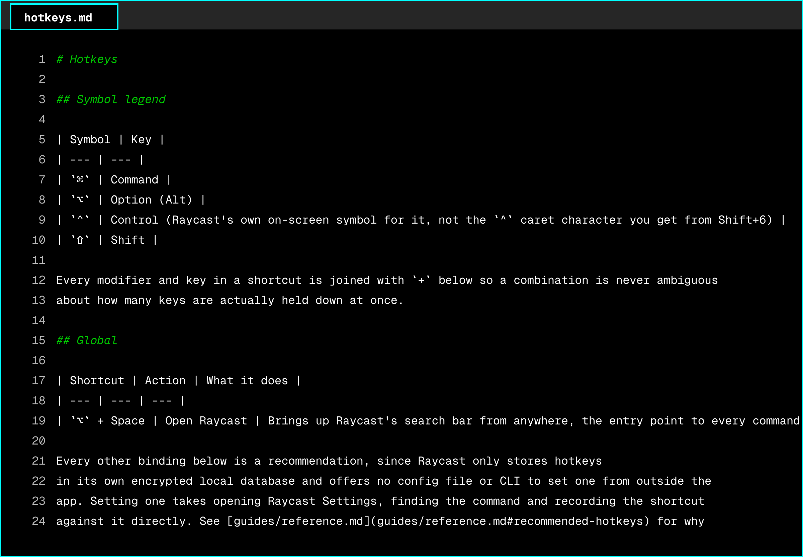

# raycast-config

This repository's Raycast configuration has moved to the `apps/raycast` folder of the dotfiles repository, where it is maintained together with the rest of the developer setup. Changes and issues are handled there.

[Open apps/raycast in dotfiles](https://github.com/zaccesss/dotfiles/tree/main/apps/raycast)

> [!NOTE]
> This repository is archived and read-only.

